 

 

 

 

 

 

✦ **languages**  
`C` `Python` `Java` `SQL`

✦ **systems**  
`Linux` `Arch` `Bash` `Git`

✦ **database**  
`PostgreSQL`

✦ **exploring**  
`Docker` `Terraform` `Cloud`

 

 

| project | area | description |
|:--|:--|:--|
| ✦ **[authopsy](https://github.com/isitasz/authopsy)** | `systems` | a Linux authentication log analyzer for detecting suspicious login attempts, identifying activity patterns, and automating security monitoring. |
| ✦ **[nyx browser](https://github.com/isitasz/nyx-browser)** | `systems` | a Firefox-based browser engineering project focused on building a custom browser, privacy engineering, security hardening, and source-level modifications. |
| ✦ **[revarchol](https://github.com/isitasz/revarchol)** | `systems` | a desktop setup for Arch Linux, featuring a custom GTK shell, system controls, desktop utilities and coordinated theming. |
| ✦ **[afterword](https://github.com/isitasz/afterword)** | `data` | a dynamic media catalog for tracking and exploring books, movies, games, and anime, featuring backend integrations and PostgreSQL persistence. |
| ✦ **[thoughtdump](https://github.com/isitasz/thoughtdump)** | `experiments` | a personal knowledge base built with MkDocs and GitHub Pages, featuring automated deployment through GitHub Actions. |

`infrastructure/` and `automation/`: i'm migrating accounts and will soon update these sections.

 

 

 

 

my contribution graph, eaten one commit at a time.

 

