 

 

 

computer science student @ UFSCar
linux ricing enthusiast, occasional gamedev
interested in systems, infrastructure & cloud

 

 

✦ **languages**  
`C` `C++` `Python` `Java` `SQL`

✦ **systems**  
`Linux` `Fish` `Git`

✦ **database**  
`PostgreSQL`

✦ **exploring**  
`Docker` `Terraform`

 

✦ systems/

 

- **[authopsy](https://github.com/isitasz/authopsy)** — a Linux authentication log analyzer for detecting suspicious login attempts and identifying activity patterns.
- **[nyx-browser](https://github.com/isitasz/nyx-browser)** — a Firefox-based browser project focused on privacy engineering, security hardening and source-level modifications.
- **[revarchol](https://github.com/isitasz/revarchol)** — an Arch Linux desktop setup featuring a custom GTK shell, system controls and coordinated theming.

✦ data/

 

- **[afterword](https://github.com/isitasz/afterword)** — a media catalog for books, movies, games and anime, with backend integrations and PostgreSQL persistence.

✦ experiments/

 

- **[thoughtdump](https://github.com/isitasz/thoughtdump)** — a personal knowledge base built with MkDocs and GitHub Pages.

✦ infrastructure/

 

under construction.

✦ automation/

 

under construction.

 

 

still working on this one. sorry...

 

 

my contribution graph, eaten one commit at a time.

 

